# Where's Gymbro? — Installer

[](LICENSE)
[](https://github.com/tyl3rde/gymbro-install/commits/main)


Eigene Instanz von „Where's Gymbro?" auf einem frischen Server, mit einem
Befehl. Das Image ist fertig gebaut (`ghcr.io/tyl3rde/gymbro`, amd64 und
arm64), auf dem Server wird nichts kompiliert.

```bash
curl -fsSL https://raw.githubusercontent.com/tyl3rde/gymbro-install/main/install.sh | sudo bash
```

Der Installer zeigt zuerst die Lizenz (Gymbro Source License 1.0) und fragt,
ob du sie annimmst. Danach richtet er Docker ein und fragt nach Domain,
E-Mail für Let's Encrypt, Admin-Name und Admin-PIN. Gibt es eine neuere Testversion,
fragt er zusätzlich, ob er statt der stabilen Version die Beta nehmen soll
(Enter = stabil). Nach etwa fünf Minuten läuft die App unter
`https://<deine-domain>`.

<!-- Erzeugt mit svg-builder aus specs/gymbro-install.json, nicht von Hand ändern. -->


## Voraussetzungen

- Ubuntu 24.04 oder Debian 12, amd64 oder arm64, ab 2 GB RAM
- öffentliche IPv4 und eine Domain, deren A-Record schon auf den Server zeigt
  (bei Cloudflare: graue Wolke, „DNS only")
- Ports 80 und 443 von außen erreichbar, root- bzw. sudo-Zugang

## Erst lesen, dann ausführen

Alles, was als root läuft, lohnt einen Blick vorher:

```bash
curl -fsSL https://raw.githubusercontent.com/tyl3rde/gymbro-install/main/install.sh -o install.sh
less install.sh
sudo bash install.sh
```

## Updates

Admins sehen neue Versionen in der App und installieren sie per Klick (nur
mit dem beweglichen Image-Tag `latest`). Von Hand:

```bash
cd /opt/gymbro && docker compose pull && docker compose up -d
```

Alles Weitere — bestehender Reverse-Proxy, Backups, Umgebungsvariablen —
steht in [INSTALL.md](INSTALL.md).

## Über dieses Repo

Die Dateien hier werden bei jedem stabilen Release automatisch aus dem
App-Repo gespiegelt. Änderungen direkt in diesem Repo überschreibt der
nächste Release.

Lizenz: ab 1.7.0 Gymbro Source License 1.0, siehe [LICENSE](LICENSE). Nur private
Nutzung, keine kommerzielle Nutzung, keine Weitergabe (Ausnahmen im Volltext).
Versionen bis 1.6.0 stehen unter der AGPL-3.0-or-later.
